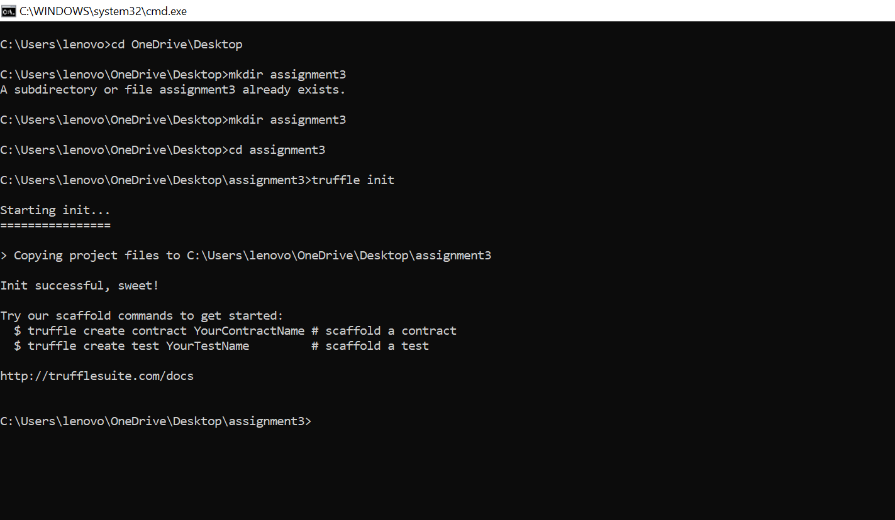
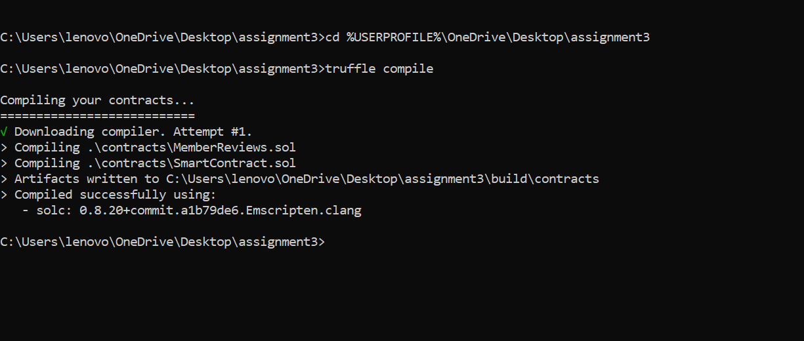
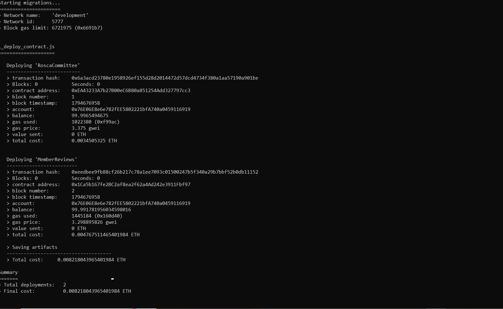
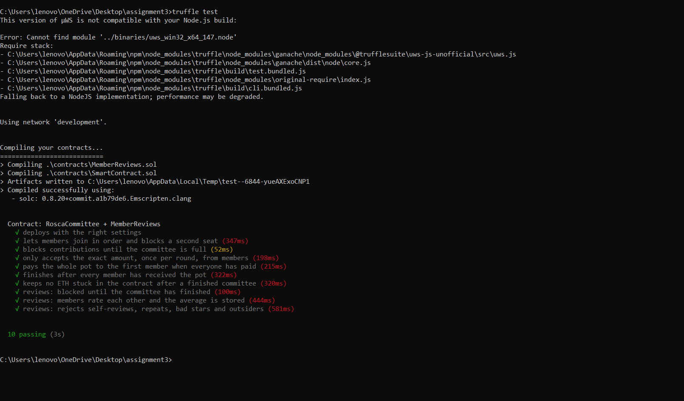
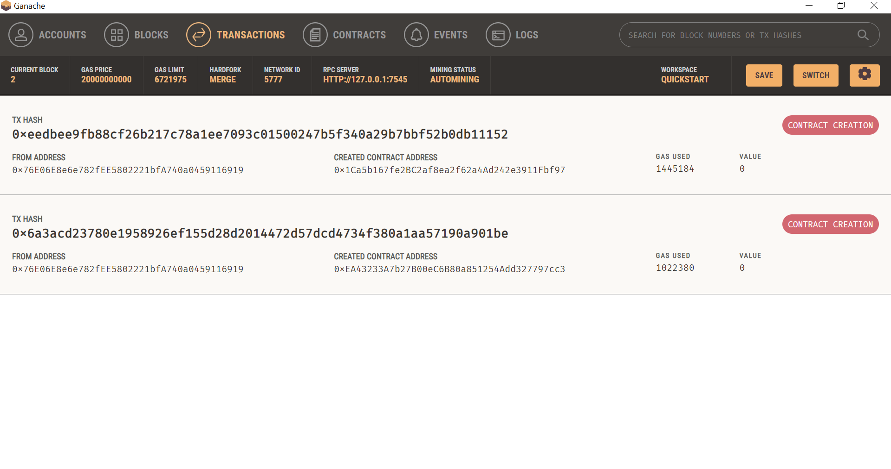
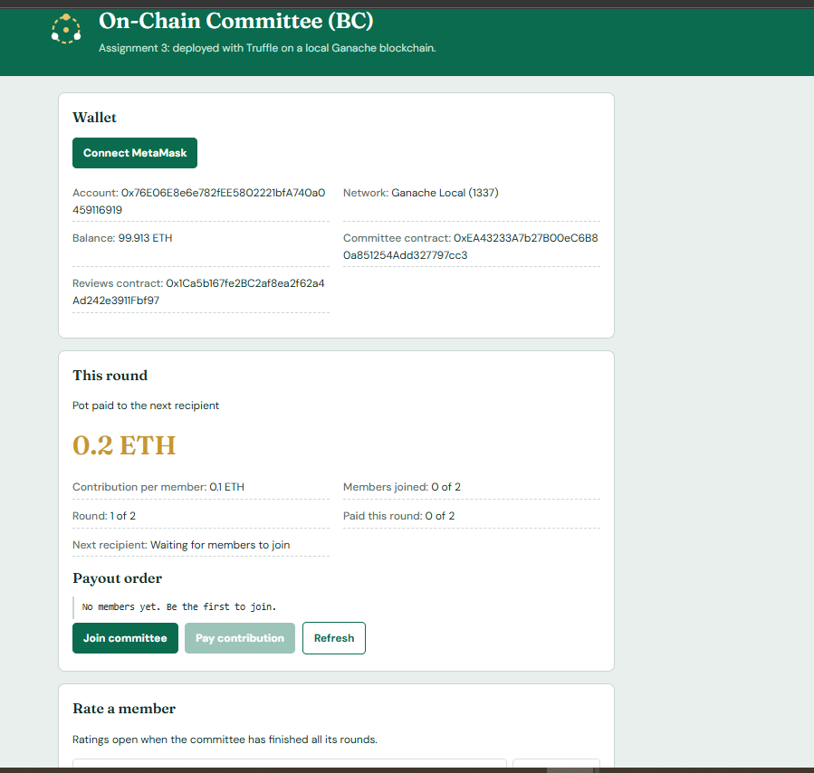
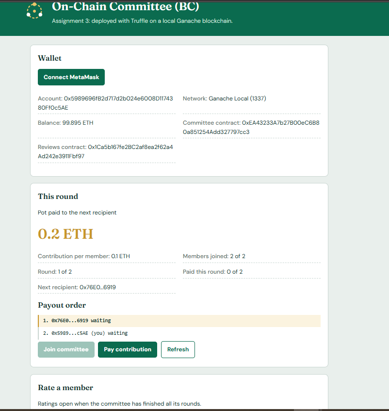
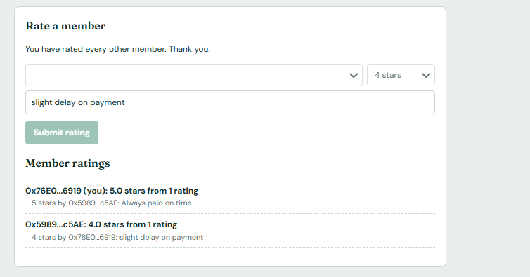

# On-Chain Committee (BC) - Truffle + Ganache

**MG3012 Blockchain Technology for Business, Assignment 3**
**Student:** Noor Minallah Chaudhry | **Roll No:** 24i-5579


This project takes the committee (BC / ROSCA) smart contract from Assignment 2 and deploys it with **Truffle** on a local **Ganache** blockchain instead of Remix. A web page lets members join, pay each round, and rate each other.

## Contracts
| File | Contract | Purpose |
|---|---|---|
| `contracts/SmartContract.sol` | `RoscaCommittee` | The Assignment 2 contract, unchanged: join, contribute, getMembers, getRoundInfo, hasPaid |
| `contracts/MemberReviews.sol` | `MemberReviews` | Bonus second contract: after the committee finishes, members rate each other 1 to 5 stars. It reads the committee contract to check membership and that it has finished |

## Project structure
```
contracts/    SmartContract.sol, MemberReviews.sol
migrations/   1_deploy_contract.js
test/         roscaCommittee.test.js (10 automated tests)
src/          index.html, script.js, style.css, logo.svg
truffle-config.js
screenshots/
```

## Setup and commands
1. Install **Node.js (LTS)**, then in Command Prompt: `npm install -g truffle`
2. Install **Ganache**, open it and click **Quickstart (Ethereum)**. RPC server: `HTTP://127.0.0.1:7545`
3. Create the project and copy these files in:
   ```
   mkdir assignment3 && cd assignment3
   truffle init
   ```
4. Compile and deploy:
   ```
   truffle compile
   truffle migrate
   ```
   (use `truffle migrate --reset` to redeploy after restarting Ganache)
5. Run the tests: `truffle test`
6. Import two Ganache accounts into MetaMask (private key from the key icon in Ganache).
7. Open the project's main folder in VS Code, right-click `src/index.html` and choose **Open with Live Server**. Connect MetaMask and approve the **Ganache Local** network.

## How the deployment works
- `truffle-config.js` connects Truffle to Ganache on `127.0.0.1:7545` and compiles with solc 0.8.20 (EVM version `paris` for Ganache compatibility).
- `migrations/1_deploy_contract.js` deploys `RoscaCommittee` (contribution 0.1 ETH, 2 members), then deploys `MemberReviews` with the committee's address.
- The frontend reads each contract's address and ABI from `build/contracts/*.json`, so no address needs to be copied by hand.

## How to test the dApp
1. Account 1: **Join committee**. Account 2 (switch in MetaMask, reconnect): **Join committee**.
2. Both accounts click **Pay contribution** each round. When the last member pays, the pot goes to that round's recipient. Repeat for round 2.
3. When the committee shows **finished**, each account can **rate** the other member. The ratings and averages appear under **Member ratings**.

## Screenshots









## Notes
- Local test blockchain only; the Ganache accounts and keys are public test accounts, never use them with real money.
- The `build/` folder is generated by `truffle compile` and is not committed.
